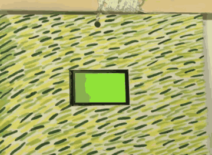
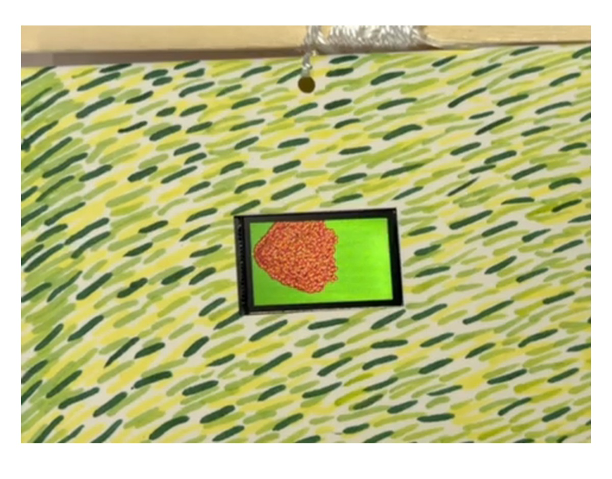

# Fire on Grass



## About

**Fire on Grass** is a generative animation for an ESP32 TTGO T-Display. It begins with one small spark on a field of green and gradually spreads into a dense, blazing form. The piece is inspired by the Chinese saying **“星星之火，可以燎原”** — “A single spark can start a prairie fire.”

After visiting the Van Gogh Museum in Amsterdam this summer, I became especially interested in Van Gogh's visible, directional brushstrokes. I painted the surrounding paper field with short marks in several greens and yellows, translating the rhythm and energy I admired into the physical installation without reproducing a specific painting.

The project explores how a tiny event can accumulate into irreversible change. Random growth makes every cycle slightly different, while the continuous reset turns destruction into a repeating visual rhythm.

- [Full design documentation and video](https://helenamoisme.github.io/creative-embedded-system-design/fire-on-grass.html)
- **Tags:** `generative-art` `esp32` `ttgo-t-display` `tft-espi` `creative-coding`

## How it works

The program stores the state of every pixel in a `135 × 240` Boolean grid. One burning cell is placed near the left edge. During each update, the program randomly samples the grid; when it finds a burning cell, it creates a new cell one to four pixels to the right and up to three pixels vertically away.

Each new point is drawn in layers:

1. A maroon circle creates the dark body of the flame.
2. An orange line connects the new point to its parent.
3. A smaller red circle and yellow center produce a hot, flickering texture.

When 85% of the grid has been marked, the display returns to olive green, pauses for one second, and starts again from a single spark.

## Hardware

- Original ESP32 TTGO T-Display with a 240 × 135 ST7789 screen
- USB cable for programming and power
- Computer running Arduino IDE
- Painted paper or board for the grass installation background
- Tape or another removable method for mounting the display

The display is built into the TTGO board, so no external display wiring is required.

## Software

- [Arduino IDE](https://www.arduino.cc/en/software)
- ESP32 board package by Espressif Systems
- [TFT_eSPI](https://github.com/Bodmer/TFT_eSPI) by Bodmer

## Repository structure

```text
fire-on-grass/
├── code/
│   └── fire-on-grass/
│       └── fire-on-grass.ino
├── media/
│   ├── fire-on-grass-demo.gif
│   ├── fire-on-grass-demo.mp4
│   └── fire-on-grass-installation.jpg
└── README.md
```

Folder names use lowercase letters and hyphens and contain no spaces.

## Reproduce the project

1. Install Arduino IDE.
2. In Arduino IDE, install the **esp32** board package by Espressif Systems through Boards Manager.
3. Install **TFT_eSPI** through Library Manager.
4. Open `TFT_eSPI/User_Setup_Select.h`, disable the default `User_Setup.h`, and enable `User_Setups/Setup25_TTGO_T_Display.h`.
5. Connect the original TTGO T-Display by USB.
6. Open [`code/fire-on-grass/fire-on-grass.ino`](code/fire-on-grass/fire-on-grass.ino).
7. Select **ESP32 Dev Module**, choose the connected serial port, and upload the sketch.
8. Paint a field of short green and yellow marks on a white board. Leave an opening sized for the display and secure the board behind it so the screen becomes part of the field.
9. Power the board. The animation starts automatically and resets after the fire reaches the threshold.

## Installation

The physical installation places the small black display at the center of a hand-painted grass field. The visible frame separates the simulation from the painted surface, while the matching greens connect the digital fire to the physical landscape.



## Design decisions

- **One directional growth:** New cells move mainly to the right, giving the fire a readable direction and making the original spark visible as the beginning of the event.
- **Layered flame marks:** Maroon, orange, red, and yellow overlap so the fire reads as heat and density rather than a flat block of color.
- **Painted movement:** Short yellow-green and dark-green strokes make the paper field feel active before the digital fire begins.
- **Olive field:** The screen background echoes the painted grass surrounding the device.
- **Random propagation:** The same rules produce a different edge and texture during every cycle.
- **Automatic reset:** Resetting after 85% coverage allows the full transformation to be experienced repeatedly during installation.

## Troubleshooting

- **Blank or incorrect display:** Confirm that `Setup25_TTGO_T_Display.h` is selected in TFT_eSPI.
- **Upload fails:** Choose the correct serial port, try a data-capable USB cable, and avoid holding the board button during upload.
- **Image is rotated:** Keep `tft.setRotation(1)` for the 240 × 135 landscape orientation.
- **Animation grows too slowly or quickly:** Adjust the `5000` iterations inside `loop()` or the final `delay(150)`.
- **Reset happens too early or late:** Change the `0.85` threshold.

## Demo video

The complete 40-second recording is available here: [fire-on-grass-demo.mp4](media/fire-on-grass-demo.mp4).

## Credits

Created by Helena Mo for Creative Embedded System Design, 2026. Built with the open-source TFT_eSPI library.
